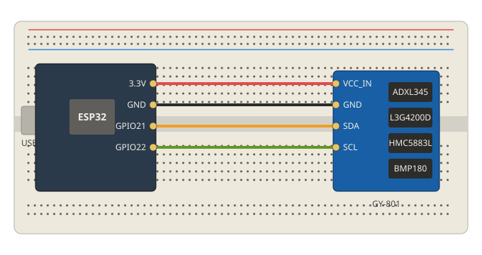

# Wiring: ESP32 + GY-801

| GY-801   | ESP32  | Wire   |
|----------|--------|--------|
| VCC_IN   | 3.3V   | red    |
| GND      | GND    | black  |
| SDA      | GPIO21 | yellow |
| SCL      | GPIO22 | green  |

## Notes
- Pin labels differ slightly between GY-801 clones. Check the silkscreen on your board.
- The GY-801 has an on-board regulator. If sensors are not detected at 3.3V, move the red wire to the ESP32 `5V/VIN` pin.
- Unused pins (`A_INT1`, `G_INT`, `M_DRDY`, ...) stay unconnected.

## I2C addresses
| Sensor            | Function      | Address |
|-------------------|---------------|---------|
| ADXL345           | Accelerometer | 0x53    |
| L3G4200D          | Gyroscope     | 0x69    |
| HMC5883L          | Magnetometer  | 0x1E    |
| BMP085 / BMP180   | Barometer     | 0x77    |

Run `firmware/i2c_scanner` first to confirm all four are detected.
